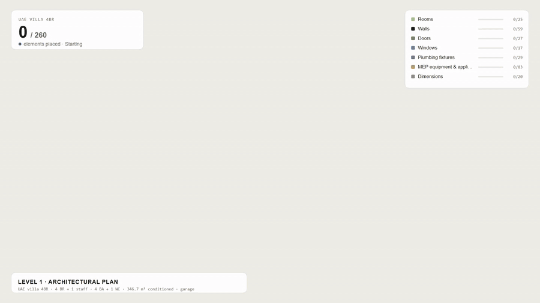

# AR Plan Generator

[](https://ahmed-elbably.github.io/ar-plan-generator/)
[](CHANGELOG.md)
[](LICENSE)
[](#requirements)
[](#install)
[](https://github.com/ahmed-elbably/ar-plan-generator/actions/workflows/pages.yml)

**[Project site](https://ahmed-elbably.github.io/ar-plan-generator/) · [Live 3D demo](https://ahmed-elbably.github.io/ar-plan-generator/examples/uae-villa-4br/uae-villa-4br.3d.html) · [Build replay](https://ahmed-elbably.github.io/ar-plan-generator/examples/uae-villa-4br/uae-villa-4br.build.html) · [AR Plan Studio](https://ahmed-elbably.github.io/ar-plan-generator/studio/ar-plan-studio.html)**

A Claude plugin that turns a written brief or a sketch into an architectural floor plan, then into a 3D model, with drawings and BIM files you can take straight into AutoCAD, Revit or Navisworks.



> "Single-storey villa, about 320 m²: majlis near the entrance with a guest WC, family living and dining, closed kitchen with pantry, maid's room with its own bathroom, laundry, 4 en-suite bedrooms, 2-car garage."

That brief produced the plan above: 25 rooms, 27 doors, 17 windows and 30 fixtures, 9/9 MEP-readiness checks, no clashes. All of its files are in [`examples/uae-villa-4br`](examples/uae-villa-4br).

## What it does

| Ask Claude | You get |
|---|---|
| "Make me a 4-bedroom villa, about 320 m², with a majlis and maid's room" | A 2D plan, 3D model, build replay, DXF, IFC, plan JSON and a check report |
| "Turn this sketch into a plan" (with an image) | The same, following the sketch's layout and written dimensions |
| "Add a store next to the garage" (with a plan JSON) | A new version that changes only what's needed, plus what changed |
| "Is this plan ready for MEP?" / "Export it to IFC" | Areas, room schedule, MEP readiness, door and fixture clashes; drawings on request |

Claude decides the layout. A bundled engine draws it: walls on every room edge, thicker exterior walls, door and window openings cut, fixtures placed against walls and kept clear of doors and door swings. Every plan is checked before you see it.

UAE / GCC conventions are the default (majlis, guest WC, maid's room, en-suites, outdoor AC units). Ask for Egypt, US (IRC) or international conventions in the brief. Briefs can be in Arabic.

## Install

### Claude Code

```
/plugin marketplace add ahmed-elbably/ar-plan-generator
/plugin install ar-plan-generator@ar-plan-generator
```

### Claude app

Download [`dist/ar-plan-generator.plugin`](dist/ar-plan-generator.plugin) and add it to Claude as a plugin file.

### Requirements

- Node.js 18 or later (the engine has no dependencies).
- Optional, for videos: `rsvg-convert` and `ffmpeg` (2D build video), plus Python Playwright with Chromium (2D-to-3D video).

## Outputs

| File | What it is |
|---|---|
| `.svg` / `.png` | The drawing, with room names, areas and exterior dimensions |
| `.dxf` | AutoCAD R12 DXF in metres, north up, walls cut at openings. Layers: `A-WALL`, `A-DOOR`, `A-GLAZ`, `A-AREA`, `A-AREA-IDEN`, `P-FIXT`, `A-EQPM`, `P-EQPM`, `M-EQPM`, `E-EQPM` |
| `.ifc` | IFC4 in metres: walls, doors, windows, a slab and a space per room (Name = number, LongName = room name), fixtures as IfcSanitaryTerminal, IfcElectricAppliance, IfcUnitaryEquipment, IfcElectricDistributionBoard and IfcWasteTerminal inside their rooms, with an `ARPlan_Fixture` property set (services, room) |
| `.3d.html` | Interactive 3D model: the plan lifts and the walls rise; then orbit, plan / 3D, cut at 1.2 m, fixtures on or off |
| `.build.html` / `.build.mp4` | Replay of the plan being built, with an elements-placed counter and the MEP checks ticking |
| `.full.mp4` | The whole story in one 1920×1080 video: 2D build, then the 3D build and orbit ([example](media/uae-villa-4br-2d-to-3d.mp4)) |
| `.plan.json` | Editable plan; opens in AR Plan Studio |
| `.report.md` | Areas, room schedule, MEP readiness and clashes |

In Revit: Insert > Link CAD (DXF, units metres) or Insert > Link IFC.

## AR Plan Studio

[`studio/ar-plan-studio.html`](studio/ar-plan-studio.html) is the interactive editor that goes with the plugin. Open it in a browser to draw and edit walls, rooms, doors, windows and fixtures, watch the MEP-readiness dashboard, open the plan in 3D, and import or export plan JSON. Opened as an artifact page in Claude, its AI panel also generates and changes plans from a description.

## Run the engine directly

```bash
cd plugins/ar-plan-generator/scripts
node arplan.js build   ../skills/generate-floor-plan/examples/uae-villa-4br.spec.json --out out --name villa
node arplan.js check   out/villa.plan.json
node arplan.js 3d      out/villa.plan.json --out out
node arplan.js ifc     out/villa.plan.json --out out
node arplan.js animate out/villa.plan.json --out out --name villa
bash render-video.sh out/villa-frames out/villa.build.mp4
python3 record-3d.py out/villa.3d.html out/villa.3d.mp4 --join out/villa.build.mp4 --joined out/villa.full.mp4
```

The spec format Claude writes is documented in [`spec-format.md`](plugins/ar-plan-generator/skills/generate-floor-plan/references/spec-format.md).

## Repository layout

```
.claude-plugin/marketplace.json   marketplace entry for Claude Code
plugins/ar-plan-generator/        the plugin: skills, engine scripts, AR Plan Studio asset
dist/ar-plan-generator.plugin     packaged plugin for the Claude app
examples/uae-villa-4br/           every output for the villa above
studio/ar-plan-studio.html        the interactive editor
media/                            demo GIF, video and plan image
site/index.html                   project site, deployed to GitHub Pages
.github/workflows/pages.yml       builds and deploys the site on every push to main
```

## Limits

- One level per plan. Rooms are rectangles; combine two for an L-shape.
- Plans are concept-stage layouts. Check structure, code compliance and dimensions before issuing drawings.
- The 3D page loads three.js from cdn.jsdelivr.net, so it needs an internet connection and WebGL.

## License

[MIT](LICENSE) © 2026 Ahmed Elbably
